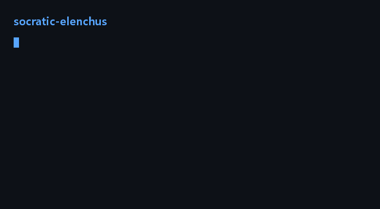

# socratic-elenchus

[](https://github.com/Karry-2026/socratic-elenchus/actions/workflows/validate.yml)

**简体中文** | [English](README.en.md)

> **English readers**: a Socratic questioning skill for AI assistants — one question per turn, no verdict handed down, and "I don't know" treated as a legitimate ending. → [Read in English](README.en.md)

> 大多数「苏格拉底式」提示词，只是教会 AI 把每个问题都变成另一个问题。结果要么是一堵永远不回答的墙，要么是一个拿着标准答案给你打分的老师。
>
> 这个都不是。它跑的是 *elenchus*——柏拉图早期对话里的反诘法——并且给它套上了让提问者不能耍赖的规则。

**版本 0.9.0 · MIT · 公开测试版** — 在第一个不是作者的人跑出结果之前，规则仍可能变。



*合成演示：由 `scripts/make_demo.py` 按固定脚本生成，不是真实录屏。*

## 一次对话实际长什么样

```text
你   我觉得好内容就是有人看的内容。
它   你的意思是：一条内容是好的，当且仅当有人看。那给我一个判断标准——
     任何人拿一条来，我怎么用它判断好不好？
你   播放量高就是好。
它   有没有一种情况，你自己会说它是好内容，但播放量很低？
你   ……有些讲得挺扎实的，播放量一般。
它   所以「播放量低」和「好」可以同时成立。那这条定义，你改还是不改？
```

```text
它   （收束）这是我的假设：你要的不是一条定义，是两条会打架的标准——对吗？
     理由链：你的反例打掉了「好＝有人看」；「有价值」又塌回「观众觉得有用」。
     最弱的一环：「有用」还没定义。留下的未解问题：两条标准冲突时，你按哪条做？
```

它不宣布判决，也不回避问题。上面这段是仓库里四段示例之一，中英双版。

## 三件它不做的事

**一、它不替你回答——但你说「直接告诉我」，它立刻给。**
「不回答」是默认值，不是教条。说这句话，你就拿到一个直接答案，同时标出不确定处。

**二、它不说「所以你错了」。**
反诘法能证明一组信念不能同时成立，证明不了哪一条为假——这在哲学文献里是活的争论，这个 skill 站在诚实的那一边。判定权归你，它只负责把冲突摆到你面前。

**三、它不把「卡住」当失败。**
aporia 是合格交付物，但要满足三个条件：你自己说出「我还不知道」、失败的结构能被复述（排除了哪些候选、为什么）、留下出口。三条不全，那只是晕。

## 它凭什么不一样

| | 常见的「苏格拉底」提示词 | socratic-elenchus |
|---|---|---|
| 不回答 | 硬规则，你求它也不给 | 默认，但留了逃生门 |
| 卡住 | 需要修掉的故障，给提示 | 合法结果，但有条件 |
| 判决 | 「所以你的定义错了」 | 「这些不能同时成立」——你判 |
| 规则 | 一段感觉 | 4 条不可破的规则 + 5 步（每步有完成标志） |
| 证据 | 「特别好用」 | 仓库里有 59 项结构校验 + 6 个场景实测（旧版 5 个 71/74，修订后 S6 两次 18/18） |
| 哲学 | 只借了个名字 | Vlastos、SEP/IEP 引文，以及 *the problem of the Socratic elenchus*（见 `references/design-notes.md`） |

## 安装

一行装（推荐）：

```bash
npx skills add Karry-2026/socratic-elenchus
```

它会装进 `.agents/skills/socratic-elenchus/`，并自动链接给 Claude Code 等宿主。也可以手动拷贝：

以下路径是 DSH 的扫描根。换宿主时，把目录换成该宿主对应的 skills 根即可——本 skill 的正文与宿主无关。

把文件夹放到被扫描的 skills 目录下：

```text
<项目>/.agents/skills/socratic-elenchus/SKILL.md
<项目>/.dsh/skills/socratic-elenchus/SKILL.md
~/.agents/skills/socratic-elenchus/SKILL.md
```

发下一条消息（或新开一个会话），它就会出现在技能目录里。`SKILL.md` 是中文版，`SKILL.en.md` 是英文版——宿主需要英文说明书时，把后者覆盖成 `SKILL.md`。

平铺成 `socratic-elenchus.md` 也能加载，但没有同级 `references/`，可选参考文件不可用；建议用文件夹形式。

## 怎么用

```text
帮我检验一下：我觉得好内容就是有人看的内容。
用苏格拉底的方式问我：我们团队应该更早发布。
这段话主张远程办公会毁掉文化——这是在论证，还是在断言？
```

也可以直接输入 `/socratic-elenchus` 调用。

## 仓库里有什么

```text
SKILL.md                    操作流程，中文版（内容以此为准）
SKILL.en.md                 同一套流程的英文版
references/design-notes.md  为什么这么定（elenchus、aporia、判定权）
references/decision.md      可选工具：现实条件、替换测试、复合排序、档位细节
references/question-types.md 九类问题自查表（卡住时换哪类问法）
examples/                   四段示例（中文），英文版在 examples/en/
docs/design.md              设计决策，比规则高一层
docs/rubric.md              10 维评测 rubric
docs/self-audit.md          两轮审查发现了什么、还剩什么
scripts/validate.py         59 项结构校验，可直接跑
test/scenarios.md           六个固定行为场景
test/RESULTS.md             实跑结果：得分、证据、发现
```

文档语言：首页 `README.md`、`SKILL.md`、`docs/rubric.md`、`test/`、`CHANGELOG.md` 为中文，内容以此为准；`README.en.md`、`SKILL.en.md`、`examples/en/`、`docs/design.md`、`docs/self-audit.md` 为英文。

## 不适合

- 有标准答案的知识点辅导（数学、代码、考试）——那种直接问解释。
- 心理治疗、法律、医疗、投资建议；出现危机信号会停止追问。
- 主持多人研讨：它只做一对一。
- 想要一个角色扮演的「苏格拉底人格」：这是流程，不是人设。

## 自己验

```bash
python scripts/validate.py --root .
```

59 项检查：frontmatter 契约、kebab-case 命名、description 触发词、引用闭环、每段示例的「一次一问」、禁用判决措辞、相对链接、中英对齐、中英 README 互链。CI 每次 push 都会跑。

行为证据在 `test/RESULTS.md`：六个场景、21 个回合，按 10 维 rubric 评分——包括两处失手（复述漂移）和它们的成因，是记录下来的，不是藏起来的。

## 参与

小修欢迎直接提 PR。改规则请先开 issue：`SKILL.md` 里每条规则都在承重，放松一条，它就退回成审讯。见 [CONTRIBUTING.md](CONTRIBUTING.md)。

## 协议

MIT，见 [LICENSE](LICENSE)。
